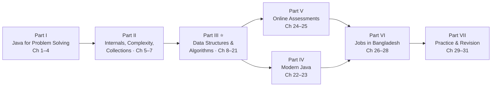
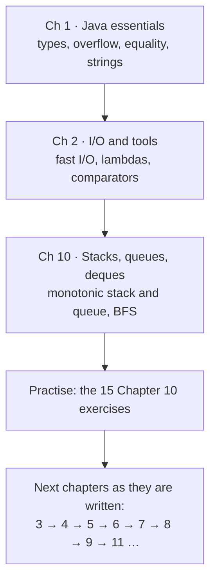
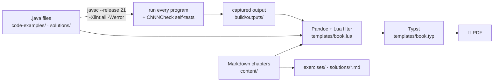

<div align="center">

# ☕ Advanced Java, DSA & Job Interview Preparation — 2026 Edition

**A self-contained textbook for CSE students who already know Java and want to use it for
data structures and algorithms, coding interviews, and backend jobs, with a focus on the
Bangladesh job market.**


### [📕 Read the PDF](Advanced_Java_DSA_Job_Preparation_2026.pdf) · [🧪 Exercises](#-exercises-and-solutions) · [💻 Run the code](#-run-the-code) · [🧠 Quick quiz](#-test-yourself) · [🔨 Rebuild](#-rebuild-the-pdf)

</div>

---

> [!NOTE]
> **This book is being written chapter by chapter.** Chapters 1, 2 and 10 are finished
> and inspected; Chapter 3 has draft code; the other chapters are planned in
> [`SYLLABUS.md`](SYLLABUS.md). [`PROGRESS.md`](PROGRESS.md) shows exactly what is done.

## 📑 Contents

- [What makes this book different](#-what-makes-this-book-different)
- [Book map and progress](#-book-map-and-progress)
- [Exercises and solutions](#-exercises-and-solutions)
- [Run the code](#-run-the-code)
- [Test yourself](#-test-yourself)
- [Suggested study path](#-suggested-study-path)
- [Rebuild the PDF](#-rebuild-the-pdf)
- [How the book is built](#-how-the-book-is-built)
- [Repository layout](#-repository-layout)
- [Continue writing the book](#-continue-writing-the-book)

## ✨ What makes this book different

| | |
|---|---|
| 🧩 **Shows how solutions are found** | Every important algorithm goes from brute force to the optimized idea, with the reasoning that connects them. |
| ✅ **Code that really runs** | Every listing in the PDF is pulled from a `.java` file that the build compiled with `javac --release 21 -Xlint:all -Werror` and ran. Program output shown in the book is captured, never typed by hand. |
| 🔁 **Self-checked** | Each chapter has a `ChNNCheck.java` that tests the examples against brute-force versions on thousands of random inputs. |
| 🔍 **Dry runs and diagrams** | Trace tables show every intermediate state; ASCII diagrams show memory and data structures. |
| 🎯 **Interview focus** | Interview tips, follow-up questions and model answers in every chapter. |
| 🇧🇩 **Local relevance** | Bangladesh-specific advice is sourced or clearly marked as general guidance, and local traps are covered (for example, `String.format` printing Bengali digits under the `bn-BD` locale). |
| 📚 **Honest sources** | Every web reference in [`references.md`](references.md) was checked, with the date. |

## 🗺 Book map and progress



**Legend:** ✅ finished and inspected · 📝 draft code only · ⬜ planned

<details open>
<summary><b>Part I — Java for Problem Solving</b> (2 of 4 done)</summary>

| # | Chapter | Status | Pages | Code | Exercises |
|---|---------|:------:|:-----:|------|-----------|
| 1 | Modern Java Essentials for DSA | ✅ | 25 | [examples](code-examples/ch01) · [solutions](solutions/ch01) | [12 exercises](exercises/ch01-modern-java-essentials.md) · [solutions](solutions/ch01-modern-java-essentials.md) |
| 2 | I/O, Standard-Library Tools and Lambda Essentials | ✅ | 26 | [examples](code-examples/ch02) · [solutions](solutions/ch02) | [12 exercises](exercises/ch02-io-library-lambdas.md) · [solutions](solutions/ch02-io-library-lambdas.md) |
| 3 | Object-Oriented Java at an Advanced Level | 📝 | – | [draft examples](code-examples/ch03) | – |
| 4 | Exceptions, Debugging, Testing and Code Quality | ⬜ | – | – | – |

</details>

<details>
<summary><b>Part II — Java Internals, Complexity and Collections</b> (0 of 3 done)</summary>

| # | Chapter | Status |
|---|---------|:------:|
| 5 | JVM, Memory and Performance | ⬜ |
| 6 | Complexity Analysis | ⬜ |
| 7 | The Java Collections Framework | ⬜ |

</details>

<details open>
<summary><b>Part III — Data Structures and Algorithms</b> (1 of 14 done)</summary>

| # | Chapter | Status | Pages | Code | Exercises |
|---|---------|:------:|:-----:|------|-----------|
| 8 | Arrays and Strings | ⬜ | – | – | – |
| 9 | Linked Lists | ⬜ | – | – | – |
| 10 | Stacks, Queues and Deques | ✅ | 37 | [examples](code-examples/ch10) · [solutions](solutions/ch10) | [15 exercises](exercises/ch10-stacks-queues-deques.md) · [solutions](solutions/ch10-stacks-queues-deques.md) |
| 11 | Hashing in Problem Solving | ⬜ | – | – | – |
| 12 | Searching and Sorting | ⬜ | – | – | – |
| 13 | Recursion and Backtracking | ⬜ | – | – | – |
| 14 | Trees and Binary Search Trees | ⬜ | – | – | – |
| 15 | Heaps and Priority Queues | ⬜ | – | – | – |
| 16 | Tries and Advanced Data Structures | ⬜ | – | – | – |
| 17 | Graphs | ⬜ | – | – | – |
| 18 | Greedy Algorithms | ⬜ | – | – | – |
| 19 | Bit Manipulation and Mathematical Algorithms | ⬜ | – | – | – |
| 20 | Dynamic Programming | ⬜ | – | – | – |
| 21 | Advanced Interview Patterns | ⬜ | – | – | – |

</details>

<details>
<summary><b>Parts IV–VII — Modern Java, Online Assessments, Jobs, Practice</b> (0 of 10 done)</summary>

| # | Chapter | Status |
|---|---------|:------:|
| 22 | Lambdas, Functional Interfaces and Streams | ⬜ |
| 23 | Other Useful Java Features | ⬜ |
| 24 | Online Judge Strategy | ⬜ |
| 25 | The Problem-Solving Workflow | ⬜ |
| 26 | Java Interview Fundamentals | ⬜ |
| 27 | Java for Backend Engineering | ⬜ |
| 28 | Bangladesh-Focused Job Preparation | ⬜ |
| 29 | Topic-Wise Practice Problems | ⬜ |
| 30 | Interview Question Bank | ⬜ |
| 31 | Revision Handbook | ⬜ |

</details>

**Also in the PDF:** cover, contents, preface, *How to Use This Book*, a 40-term glossary,
references and an index.

## 🧪 Exercises and solutions

Every chapter ends with graded exercises (**Easy**, **Medium**, **Hard**, **Challenge**)
and worked solutions. Try each exercise before opening its solution.

| Chapter | Exercises | Worked solutions | Solution programs |
|---------|-----------|------------------|-------------------|
| 1 · Java essentials | [exercises/ch01…](exercises/ch01-modern-java-essentials.md) | [solutions/ch01…](solutions/ch01-modern-java-essentials.md) | [`solutions/ch01/`](solutions/ch01) |
| 2 · I/O, lambdas, sorting | [exercises/ch02…](exercises/ch02-io-library-lambdas.md) | [solutions/ch02…](solutions/ch02-io-library-lambdas.md) | [`solutions/ch02/`](solutions/ch02) |
| 10 · Stacks and queues | [exercises/ch10…](exercises/ch10-stacks-queues-deques.md) | [solutions/ch10…](solutions/ch10-stacks-queues-deques.md) | [`solutions/ch10/`](solutions/ch10) |

<details>
<summary>📋 <b>Printable checklist</b>: copy it into your notes and tick as you go</summary>

**Chapter 1: Modern Java essentials**
- [ ] 1.1 Predict the output (Easy)
- [ ] 1.2 Fix the midpoint (Easy)
- [ ] 1.3 The role check that only works in tests (Easy)
- [ ] 1.4 A real deep copy (Easy)
- [ ] 1.5 Sums without silent overflow (Medium)
- [ ] 1.6 Letter counts with an array (Easy)
- [ ] 1.7 Reverse the words (Medium)
- [ ] 1.8 Trace the calls (Easy)
- [ ] 1.9 Valid palindrome (Medium)
- [ ] 1.10 Factorial modulo a prime (Medium)
- [ ] 1.11 Run-length encoding in linear time (Hard)
- [ ] 1.12 Detect overflow yourself (Hard)

**Chapter 2: I/O, library tools and lambdas**
- [ ] 2.1 Tokens across lines (Easy)
- [ ] 2.2 Count lines, words and characters (Easy)
- [ ] 2.3 By length, then alphabetically (Easy)
- [ ] 2.4 Break the subtraction comparator (Medium)
- [ ] 2.5 Sort intervals (Medium)
- [ ] 2.6 Descending primitives (Medium)
- [ ] 2.7 Group by first letter (Medium)
- [ ] 2.8 Word frequencies (Easy)
- [ ] 2.9 Beyond long (Medium)
- [ ] 2.10 Exact money (Medium)
- [ ] 2.11 Distinct values per test case (Hard)
- [ ] 2.12 Parse a line by hand (Challenge)

**Chapter 10: Stacks, queues and deques**
- [ ] 10.1 Predict the output (Easy)
- [ ] 10.2 Where is the error? (Easy)
- [ ] 10.3 A fixed-capacity circular queue (Easy)
- [ ] 10.4 Min stack (Medium)
- [ ] 10.5 Days until a warmer day (Medium)
- [ ] 10.6 Stock span (Medium)
- [ ] 10.7 Simplify a path (Medium)
- [ ] 10.8 Decode a string (Medium)
- [ ] 10.9 Asteroid collision (Medium)
- [ ] 10.10 First negative number in every window (Medium)
- [ ] 10.11 Remove k digits (Hard)
- [ ] 10.12 Sum of subarray minimums (Hard)
- [ ] 10.13 Rotting oranges (Medium)
- [ ] 10.14 Maximal rectangle in a binary matrix (Challenge)
- [ ] 10.15 Amortized cost, carefully (Medium)

</details>

## 💻 Run the code

Every program is plain Java with no package and no dependencies. You need a JDK 21 or
newer.

```bash
cd code-examples/ch10
javac BalancedParentheses.java
java BalancedParentheses
```

Programs that read input have a matching `.in` file next to them:

```bash
cd code-examples/ch02
javac OaTemplate.java
java OaTemplate < OaTemplate.in
```

<details>
<summary>💡 <b>Highlights worth running first</b></summary>

| Program | What it shows |
|---------|---------------|
| [`ch01/NumericTraps.java`](code-examples/ch01/NumericTraps.java) | overflow, `long wrong = a * b`, integer division, `0.1 + 0.2`, the midpoint bug |
| [`ch01/EqualityDemo.java`](code-examples/ch01/EqualityDemo.java) | `==` versus `equals`, the string pool, the `Integer` cache |
| [`ch01/ShowBytecode.java`](code-examples/ch01/ShowBytecode.java) | the JVM bytecode that `javac` produced (`iload`, `iadd`, `ireturn`) |
| [`ch02/IoBenchmark.java`](code-examples/ch02/IoBenchmark.java) | measured speed of `Scanner`, `BufferedReader` and a fast reader on one million numbers |
| [`ch02/LocaleTrap.java`](code-examples/ch02/LocaleTrap.java) | why `String.format("%.2f")` can print `৩.৫০` |
| [`ch02/OaTemplate.java`](code-examples/ch02/OaTemplate.java) | a reusable online-assessment template |
| [`ch02/SortingWithComparators.java`](code-examples/ch02/SortingWithComparators.java) | safe comparators, and how `(a, b) -> a - b` breaks |
| [`ch10/NextGreater.java`](code-examples/ch10/NextGreater.java) | the monotonic stack, O(n²) → O(n) |
| [`ch10/LargestRectangle.java`](code-examples/ch10/LargestRectangle.java) | largest rectangle in a histogram |
| [`ch10/SlidingWindowMax.java`](code-examples/ch10/SlidingWindowMax.java) | the monotonic deque |

</details>

<details>
<summary>🔁 <b>Run a chapter's self-checks</b></summary>

```bash
cd code-examples/ch10
javac *.java
java -ea Ch10Check
```

`Ch10Check` compares every Chapter 10 example with a brute-force version on thousands of
random inputs and prints `Ch10Check: all checks passed`. Solution folders have their own
`ChNNSolutionsCheck.java`.

</details>

## 🧠 Test yourself

Click a question to reveal the answer. Each one comes from a finished chapter.

<details>
<summary><b>Q1.</b> What does <code>long big = 50_000 * 50_000;</code> store?</summary>

**−1,794,967,296.** Both operands are `int`, so the multiplication happens in `int` and
overflows *before* the result is widened to `long`. Write `50_000L * 50_000` or
`(long) a * b`. → Chapter 1, *Overflow*.

</details>

<details>
<summary><b>Q2.</b> With <code>Integer a = 1000, b = 1000;</code>, what is <code>a == b</code>?</summary>

**`false`** with default JVM settings. Only values from −128 to 127 are guaranteed to be
cached by `Integer.valueOf`; larger values are separate objects, and `==` compares
references. Use `a.equals(b)`. → Chapter 1, *Equality*.

</details>

<details>
<summary><b>Q3.</b> Your program prints with a <code>PrintWriter</code>, but the judge sees no output. Why?</summary>

You forgot **`out.flush()`** (or `close()`) at the end of `main`. Buffered output that is
never flushed is never written. → Chapter 2, *Writing output fast*.

</details>

<details>
<summary><b>Q4.</b> Why is <code>(a, b) -> a - b</code> a dangerous comparator?</summary>

`a - b` **overflows** when the values are far apart (for example `Integer.MIN_VALUE - 1`),
giving the wrong sign. Use `Integer.compare(a, b)` or `Comparator.comparingInt(...)`.
→ Chapter 2, *Sorting*.

</details>

<details>
<summary><b>Q5.</b> The "next greater element" algorithm has a <code>while</code> inside a <code>for</code>. Why is it still O(n)?</summary>

Count the work per element, not per loop: each index is **pushed once and popped at most
once**, so the total number of pops over the whole run is at most n. → Chapter 10,
*Monotonic stacks*.

</details>

<details>
<summary><b>Q6.</b> Why should you prefer <code>ArrayDeque</code> to <code>java.util.Stack</code>?</summary>

`Stack` extends `Vector`: every method is **synchronized** (slower, useless in
single-threaded code), it allows index operations like `add(0, x)` that break LIFO, and it
iterates bottom-to-top. Its own documentation recommends `Deque`. → Chapter 10, *Why not
java.util.Stack?*

</details>

## 🧭 Suggested study path



For each chapter: read it in the PDF with its `code-examples` folder open, run and change
the programs, do the exercises yourself, and only then compare with the solutions. A full
12-week and 16-week roadmap will be added as `study_roadmap.md` once the core chapters
are complete.

## 🔨 Rebuild the PDF

You need **Python 3.10+**, **Pandoc 3.x**, **Typst 0.13+** and a **JDK 21 or newer**.

```bash
winget install --id JohnMacFarlane.Pandoc --exact
```

```bash
winget install --id Typst.Typst --exact
```

```bash
python scripts/build.py
```

<details>
<summary>⚙️ <b>Build options and helper scripts</b></summary>

| Command | What it does |
|---------|--------------|
| `python scripts/build.py` | full build: compile and run all Java, check content, regenerate exercises/solutions, build the PDF, write `validation-report.md` |
| `python scripts/build.py --png 1-10` | also render pages 1–10 to `build/png/` for visual inspection |
| `python scripts/build.py --skip-java` | reuse the previous program outputs (faster) |
| `python scripts/check.py` | content checks only (forbidden phrases, required sections, code line length, includes) |
| `python scripts/listing.py <file.java> [region]` | print a listing with the line numbers used in the PDF |
| `python scripts/glossary.py merge <terms.md>` | merge new terms into the sorted glossary |

The build finds `pandoc`, `typst` and `javac` on `PATH`, in their usual install folders, or
through the `PANDOC`, `TYPST` and `JAVA_HOME` environment variables. Android Studio's
bundled JDK also works.

</details>

The latest build report is in [`validation-report.md`](validation-report.md).

## 🏗 How the book is built



<details>
<summary>✍️ <b>Writing conventions for chapter sources</b></summary>

Chapters use Pandoc Markdown plus a few conventions handled by `templates/book.lua`:

````text
::: {.definition title="Stack"}       boxes: definition, note, warning, tip, example,
...                                    optional, keyidea, objectives, quiz
:::

```{.java include="code-examples/ch10/Foo.java"}              whole program
```
```{.java include="code-examples/ch10/Foo.java" region="push"}  one region
```
```{.output from="code-examples/ch10/Foo"}                    captured output
```

::: {.exercise number="10.1" level="Easy" title="..."}
:::
::: {.solution number="10.1"}
:::

[]{.ref to="section-id"}    cross-reference        [term]{.idx}    index entry
## Heading {.optional}      optional material
````

A bare `java` code block is rejected: every Java listing must come from a file the build
compiled. Full rules are in [`CLAUDE.md`](CLAUDE.md).

</details>

## 📂 Repository layout

<details>
<summary>Show the folder tree</summary>

```text
Java_Advance/
├── Advanced_Java_DSA_Job_Preparation_2026.pdf   the book
├── content/                 chapter sources (Markdown) and book.json (order, budgets, status)
│   ├── front/               preface, how to use this book
│   └── back/                glossary
├── code-examples/chNN/      every program in the book, plus ChNNCheck.java self-tests
├── solutions/chNN/          solution programs, plus ChNNSolutionsCheck.java
├── exercises/  solutions/*.md   exercises and worked solutions (generated by the build)
├── templates/               book.typ (page design) and book.lua (Pandoc filter)
├── scripts/                 build.py, check.py, extract.py, listing.py, glossary.py
├── references.md            sources, each link checked with a date
├── references/problems.csv  practice-problem links with verification status
├── research/job-descriptions/   job postings you collect for Chapter 28
├── validation-report.md     what the last build compiled, ran and checked
├── CLAUDE.md                project rules: teaching method, code rules, accuracy rules
├── SYLLABUS.md              full curriculum: 31 chapters, tiers, page budgets
├── PROGRESS.md              chapter and topic checklist, session log
└── KICKOFF_PROMPT.md, CONTINUE_PROMPT.md   prompts for continuing with Claude Code
```

</details>

## 🤖 Continue writing the book

The book is written with [Claude Code](https://claude.com/claude-code), one or two chapters
per session:

1. Open a Claude Code session in this folder. It reads [`CLAUDE.md`](CLAUDE.md)
   automatically.
2. Paste the contents of [`CONTINUE_PROMPT.md`](CONTINUE_PROMPT.md).
3. It reads [`SYLLABUS.md`](SYLLABUS.md) and [`PROGRESS.md`](PROGRESS.md), writes the next
   chapter with its programs, exercises and solutions, builds and inspects the PDF,
   updates the progress file, and commits.

<details>
<summary>📌 <b>Next steps</b></summary>

- [x] Toolchain, templates and build scripts
- [x] Front matter, glossary, references, index
- [x] Chapter 10 (pilot), Chapter 1, Chapter 2
- [ ] Chapter 3: draft programs exist; solutions and text still to write
- [ ] Chapters 4–9 and 11–31
- [ ] Study roadmap (12- and 16-week), setup appendix
- [ ] Chapter 28: needs real job postings in `research/job-descriptions/`
- [ ] Final full validation and version 1.0

</details>

---

<div align="center">

Built with Java 21 · Pandoc · Typst · written with Claude Code

</div>
